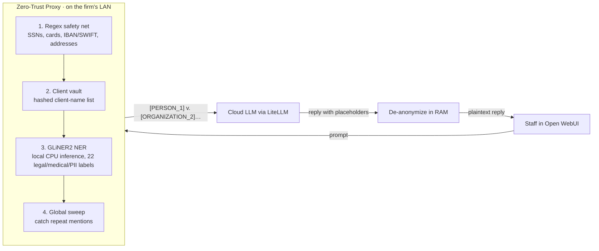

# Zero-Trust LLM Firewall

An on-premises gateway that lets law firms use frontier LLMs (Claude, GPT) **without sending client-identifying data to the cloud**. Every prompt is scanned locally. Names, case details, financial identifiers and health information are swapped for placeholder tokens before the request leaves the network. The model's reply is then restored to plain text on the way back.

Built as the core of the *Zero-Trust AI Edge Gateway*, a hardware appliance product from Elm Tech Solutions LLC.

## Why

Lawyers want generative AI for drafting and contract analysis. But pasting case files into a public LLM puts attorney-client privilege at risk (ABA Formal Opinion 512, Model Rule 1.6). This proxy sits between staff and the model, so redaction happens automatically instead of depending on people remembering to do it.

## How it works



- **Per-request entity vault.** The placeholder ↔ original mapping exists only in memory for the lifetime of one request.
- **Audit log of metadata only.** Records timestamp, verified user (from Open WebUI's signed JWT), model, entity counts and latency. Prompt text is never logged.
- **Three lanes, chosen by model name:**
  - `claude-*` / `gpt-*`: the redacted zero-trust lane
  - `elm-tech-auditor`: returns the redacted payload without calling any LLM, so compliance staff can see exactly what would leave the building
  - `public-research-base`: an unredacted, streaming lane for general research that involves no client data

## Features

- OpenAI-compatible API (`/v1/chat/completions`, `/v1/models`), so it works as a drop-in backend for Open WebUI
- Multi-pass redaction: deterministic regex → hashed client list → zero-shot NER (GLiNER2) → global consistency sweep
- Placeholders are kept consistent across multi-turn conversations and partial-name mentions ("Jane Smith" … "Smith")
- Monthly executive PDF report (ReportLab) covering redaction volume, threat categories, model usage and API cost. It is emailed automatically on the 1st of each month.
- Log lifecycle: monthly JSONL files, gzip compression, 90-day retention
- Zero-retention script that wipes Open WebUI chat history, uploads and vector stores

## Tech stack

Python 3.11 · FastAPI · LiteLLM · GLiNER2 (Fastino PII model, CPU) · ReportLab · Resend · Docker Compose · Open WebUI

## Quickstart

```bash
cp .env.example .env        # add your API keys and a WEBUI_SECRET_KEY
docker compose up --build
```

- Open WebUI: http://localhost:3000
- Proxy (localhost only): http://127.0.0.1:8000

For development with hot reload:

```bash
docker compose -f docker-compose.yml -f docker-compose.dev.yml up --build
```

## API

| Method | Path | Purpose |
|---|---|---|
| `GET` | `/v1/models` | Models offered to Open WebUI |
| `POST` | `/v1/chat/completions` | Redact → forward → restore |
| `POST` | `/v1/vault/sync` | Load a client-name list; only SHA-256 hashes are kept |
| `GET` | `/v1/audit/report?month=YYYY_MM` | Monthly audit metrics as JSON |
| `GET` | `/v1/audit/pdf` | Current month's executive PDF report |
| `POST` | `/v1/admin/force-audit-delivery` | Build and email a report on demand |

## Testing

Each product promise made to firms is mapped to the tests that verify it in [docs/product.md](docs/product.md). The tests run in three tiers:

```bash
pip install -r requirements-dev.txt
pytest                              # fast tier (~15 s): pipeline logic, all three lanes, audit log; NER model stubbed
ZT_REAL_MODEL=1 pytest -m model     # model tier (~40 s): real GLiNER2 on every promised entity type
python evals/benchmark.py           # full tier (~13 min): CUAD recall benchmark below
```

Leak tests send prompts through the real FastAPI app and capture everything that would be sent to the LLM. Known gaps are written as strict `xfail` tests, so each one is documented and fixing it is enforced.

## Evaluating redaction

The `evals/` folder measures redaction **recall**: how many known sensitive entities the engine caught. It runs against real commercial contracts from the CUAD dataset, each paired with a hand-labelled ground-truth list.

```bash
python evals/benchmark.py            # recall + latency per contract, list of leaks
python evals/document_stress_test.py # ~12k-word contract through the running proxy
python evals/verify_redaction.py     # leak and stopword-regression check on that output
```

**Latest results** (Oct 2026, CPU-only laptop):

| Contract | Words | Entities | Caught | Recall | Time |
|---|---:|---:|---:|---:|---:|
| #1 Co-branding agreement | 4,467 | 22 | 22 | 100.0% | 51 s |
| #2 Services agreement | 4,115 | 15 | 14 | 93.3% | 41 s |
| #3 Clinical research alliance | 15,471 | 41 | 38 | 92.7% | 149 s |
| #4 Bank stock-offering agency | 17,813 | 44 | 40 | 90.9% | 157 s |
| #5 Aircraft maintenance agreement | 34,155 | 65 | 57 | 87.7% | 396 s |
| **Total** | **76,021** | **187** | **171** | **91.4%** | |

Scoring is deliberately strict: if any two-word fragment of a multi-word entity survives (for example "Cancer Center" from a hospital name), the whole entity counts as a leak. Most remaining misses are international street addresses and government bodies. Throughput is about 11 s per 1,000 words on CPU, which is the main performance target.

## Project structure

```
main.py                 FastAPI proxy: redaction engine, routing, audit, reporting
tests/                  pytest suite: fast tier + model tier (tests/model/)
evals/                  Redaction benchmarks + CUAD fixtures (outputs → evals/output/, gitignored)
scripts/                Ops utilities: chat pruning, vault sync, smoke and stress tests
assets/                 Report branding
Dockerfile              Proxy image (model weights baked in at build time)
docker-compose*.yml     Proxy + Open WebUI stack, dev override
```

## Roadmap

- Extend redaction to system-role and multi-part (attachment) messages
- Keyed hashing (HMAC) for the client vault, and a tamper-evident audit log
- Automated eval suite with a recall threshold enforced in CI
- Split `main.py` into modules (engine, routing, audit, reporting)
- Authentication on admin and vault endpoints

## Data attribution

Contract fixtures in `evals/fixtures/` come from the [Contract Understanding Atticus Dataset (CUAD)](https://www.atticusprojectai.org/cuad) by The Atticus Project, licensed under [CC BY 4.0](https://creativecommons.org/licenses/by/4.0/). They are public SEC filings used here only as test material.
