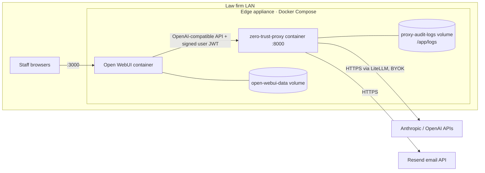

# Architecture

How the proxy works today. All application code lives in `main.py`. Components below are named by function or class so this stays accurate as line numbers change.

## Deployment

- The proxy port is bound to `127.0.0.1` on the host, so LAN users can only reach it through Open WebUI. Open WebUI is exposed on `:3000`.
- Open WebUI is configured with `OPENAI_API_BASE_URL=http://zero-trust-proxy:8000/v1`, so it treats the proxy as an OpenAI endpoint.
- Both containers share `WEBUI_SECRET_KEY` from `.env`. Open WebUI signs a per-user JWT (`x-openwebui-user-jwt`), and the proxy verifies it to attribute audit entries.
- The GLiNER2 model (`fastino/gliner2-privacy-filter-PII-multi`) is downloaded at image build time and runs on CPU. Redaction needs no internet access.

## Request lifecycle: `POST /v1/chat/completions`

The `model` field picks one of three lanes:

| Model | Lane | Redacted? | Upstream call? | Streaming? |
|---|---|---|---|---|
| `claude-*`, `gpt-*` | Zero-trust | Yes | Yes | No (forced off) |
| `elm-tech-auditor` | Auditor | Yes | **No**; returns the redacted text | No |
| `public-research-base` | Public research | **No** | Yes (mapped to `gpt-4o-mini`) | Yes, if requested |

Zero-trust lane, step by step:

1. Create a fresh `EntityVault` for this request only.
2. For each message with `role != "system"` and string `content`, run `vault.anonymize_text` in a worker thread.
3. If the conversation has no system message, insert `SYSTEM_PROMPT`. It tells the model to keep `[LABEL_N]` placeholders intact.
4. Resolve the user identity: the verified JWT email, then the Open WebUI headers, then `payload["user"]`.
5. Call `litellm.completion` synchronously, then record the upstream token count.
6. Write one audit line (metadata only).
7. Run `vault.deanonymize_text` on the response, replacing each placeholder with its original value, and return it.

## Redaction engine: `EntityVault.anonymize_text`

Text is split into 400-word chunks (`chunk_text`). Each chunk goes through the following steps in order. Later steps skip spans that earlier steps already replaced.

| Step | Mechanism | Catches |
|---|---|---|
| 0. Regex safety net | `REGEX_PATTERNS` | Card numbers, SSNs, emails, US/UK addresses, URLs, SWIFT/IBAN, `LLP`/`LLC`/`Inc.` names, `…, Esq.` |
| 1. Client vault | Every 1–5-word n-gram is normalized, SHA-256 hashed and checked against `CLIENT_HASH_VAULT` | Known client and firm names synced via `/v1/vault/sync` → `[PROTECTED_CLIENT_N]` |
| 2. Context NER | GLiNER2 zero-shot over `PII_LABELS` (22 labels), `threshold=0.30`, then filtered by `STOPWORDS`, punctuation and existing tokens | Names, parties, case names, diagnoses, medications, IDs, locations |
| 3. Global sweep | After the chunks are rejoined, every value already in `entity_map` is replaced everywhere, case-insensitive | Repeat mentions in other chunks, partial names |

Supporting details:
- `_register_and_replace` gives each distinct value one stable token per request, so "Jane Smith" is `[PERSON_1]` every time it appears. For person, organization, party and case labels, it also maps name parts longer than 3 characters (all parts for people, only the first word for organizations). That way a later "Smith" also becomes `[PERSON_1]`.
- Vault and NER matches are de-overlapped (leftmost wins; at the same start, longest wins). Replacements run from the end of the text backward so character offsets stay valid. Regex matches (step 0) are **not** de-overlapped. Two patterns matching overlapping spans could corrupt the text; this needs a test.
- `STOPWORDS` is the main tool for precision: it stops legal boilerplate ("Indemnifying Party", "Section") from being redacted. Adding words here can lower recall, so benchmark any change.

## Audit and reporting

| Component | Trigger | What it does |
|---|---|---|
| `write_audit_log` | Each chat request, except Open WebUI background prompts | Appends one JSON line to `/app/logs/audit_YYYY_MM.jsonl` |
| `log_lifecycle_manager` | Startup, then every 24 h | Gzips past months' logs; deletes archives older than 90 days |
| `generate_audit_report` | `GET /v1/audit/report?month=` | Aggregates a month: totals, entity categories, model usage, ROI (`PRICING` table vs. flagship rate), itemized ledger |
| `render_executive_pdf` | `GET /v1/audit/pdf`, scheduler, force endpoint | ReportLab PDF: summary, ROI, threat chart, ledger |
| `automated_report_scheduler` | Midnight on the 1st (container TZ is America/New_York) | Builds last month's PDF and emails it via `send_monthly_audit_email` (Resend) |

## Data stores

| Data | Location | Contents | Retention |
|---|---|---|---|
| Entity vault | Process memory, per request | Placeholder ↔ original value | Discarded when the request ends |
| Client hash vault | `/app/logs/client_hashes.json` + memory | SHA-256 of normalized client names | Until replaced |
| Audit log | `/app/logs/audit_YYYY_MM.jsonl(.gz)` | Timestamp, user, model, entity counts, char count, latency, upstream tokens | 90 days |
| Open WebUI data | `open-webui-data` volume | Users, settings, and chats until `scripts/prune_chats.sh` wipes them | Set by how often the prune script runs |
| Container stdout | Docker logs | Includes the redacted outbound payload (debug print) | Docker's log settings |

## Security model

Trust boundary: everything inside the appliance is trusted, and everything past LiteLLM is not. These invariants must hold. Changes that touch them need a test proving they still do:

1. In the zero-trust lane, no message content reaches LiteLLM without going through `anonymize_text`.
2. Original values exist only in memory for the duration of one request (except the client vault, which stores hashes only).
3. Nothing persisted (audit logs, report PDFs, emails) contains prompt or response text.
4. Only Open WebUI can reach the proxy (localhost binding). The admin and vault endpoints currently rely on this, since they have no authentication.

Known gaps against these invariants are tracked as GitHub issues labelled `security`.

## Configuration

All settings come from environment variables, listed in [`.env.example`](../.env.example). Things that are still hardcoded in `main.py` and are candidates for configuration: `PII_LABELS`, `REGEX_PATTERNS`, `STOPWORDS`, the GLiNER threshold (0.30), the chunk size (400 words), the `PRICING` table, the model list in `/v1/models`, and `/app/logs` paths.
